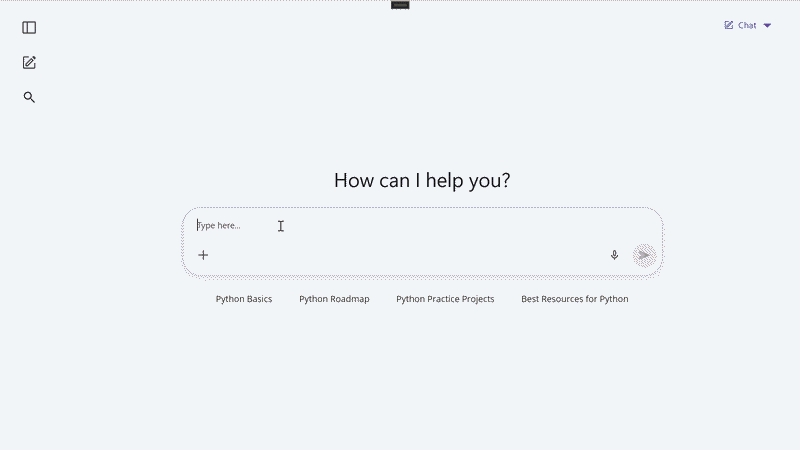

# AI-Powered Context-Aware Suggestions in .NET MAUI AI AssistView

This sample demonstrates how to build an intelligent conversational experience using the Syncfusion® .NET MAUI AI AssistView (`SfAIAssistView`) control and Azure OpenAI.

The application generates AI responses and dynamically provides context-aware suggestions based on the current conversation. These suggestions help users continue learning or explore related topics without manually typing additional prompts.

## Features

- Azure OpenAI integration
- AI-generated responses
- Context-aware follow-up suggestions
- Built-in response actions (Like, Dislike, and Copy)
- Initial prompt suggestions
- MVVM architecture
- .NET MAUI implementation using Syncfusion AI AssistView

## How It Works

1. The user submits a prompt through the AI AssistView.
2. The prompt is sent to Azure OpenAI.
3. Azure OpenAI returns a structured JSON response containing:
   - AI-generated answer
   - Four context-aware suggestions
4. The response is displayed in the AI AssistView.
5. Suggested follow-up prompts are shown below the response, allowing users to continue the conversation with a single tap.

## Demo

The following video demonstrates AI-generated responses with context-aware follow-up suggestions.

## Requirements to run the demo

To run the demo, refer to https://help.syncfusion.com/maui/system-requirements

## Prerequisites

Before running the sample, ensure that you have:

- Visual Studio 2022 with .NET MAUI workload installed
- .NET 9 or later
- Azure OpenAI resource and deployment
- Syncfusion .NET MAUI Data Grid package
- Valid Syncfusion license key

## Troubleshooting

### Path too long exception

If you encounter a "Path Too Long" exception while building the project, close Visual Studio, rename the repository folder to a shorter name, and rebuild the project.

## License

Syncfusion has no liability for any damage or consequence that may arise from using or viewing the samples. The samples are for demonstrative purposes. If you choose to use or access the samples, you agree to not hold Syncfusion liable, in any form, for any damage related to use, for accessing, or viewing the samples. By accessing, viewing, or seeing the samples, you acknowledge and agree Syncfusion's samples will not allow you seek injunctive relief in any form for any claim related to the sample. If you do not agree to this, do not view, access, utilize, or otherwise do anything with Syncfusion's samples.