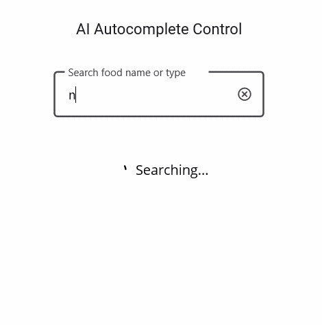

# AI-Powered Smart Filter in .NET MAUI AutoComplete

This sample demonstrates AI-powered smart filtering with the Syncfusion® .NET MAUI AutoComplete. The application integrates Azure OpenAI to understand natural language search queries and intelligently suggest matching items.

## Overview

Traditional filtering relies on exact text matching, which can limit the ability to discover relevant items when users enter descriptive phrases, incomplete keywords, or misspelled text.

This sample uses Azure OpenAI to analyze user intent and provide intelligent matching suggestions based on the meaning of the search query.

The AI-powered filtering engine considers:

- Natural language queries
- Spelling variations and corrections
- Semantic similarity
- Contextual relevance
- Related item names
- User intent

For example, users can search using phrases such as:

```text
healthy food

something spicy

vegetarian snacks

sweet dessert
```

Azure OpenAI interprets the search intent and returns the most relevant suggestions.

The filtered results are displayed directly in the Syncfusion® .NET MAUI AutoComplete, providing a smarter and more intuitive search experience.

## Key Features

- Syncfusion® .NET MAUI AutoComplete integration
- Azure OpenAI-powered smart filtering
- Natural language search support
- Intelligent suggestion generation
- Semantic item matching
- Spelling correction support
- Custom filtering using AutoCompleteFilterBehavior
- Real-time AI-powered suggestions
- Context-aware search experience
- Cross-platform .NET MAUI application

## Sample

```xml
<inputs:SfAutocomplete
    x:Name="autoComplete"
    IsEditable="True"
    DisplayMemberPath="FoodName">

    <inputs:SfAutocomplete.FilterBehavior>
        <local:SmartAutocompleteFilterBehavior />
    </inputs:SfAutocomplete.FilterBehavior>

</inputs:SfAutocomplete>
```

## Output

The AI-powered filter analyzes the user's input and suggests items that best match the intended meaning.

Example searches:

```text
healthy breakfast
```

Suggested items:

```text
Oatmeal
Fruit Salad
Greek Yogurt
```

Example searches:

```text
spicy food
```

Suggested items:

```text
Spicy Chicken Wrap
Mexican Taco
Hot Wings
```

Example searches:

```text
sweet dessert
```

Suggested items:

```text
Chocolate Cake
Cheesecake
Ice Cream
```

The results are updated dynamically as the user types, providing a fast and intelligent recommendation experience.



## Prerequisites

Before running the sample, ensure that you have:

- Visual Studio 2022 with .NET MAUI workload installed
- .NET 9 or later
- Azure OpenAI resource and deployment
- Syncfusion® .NET MAUI AutoComplete package
- Valid Syncfusion® license key

## Troubleshooting

### Path Too Long Exception

If you encounter a **"Path Too Long"** exception while building the project:

1. Close Visual Studio.
2. Rename the repository folder to a shorter name.
3. Delete the `bin`, `obj`, and `.vs` folders.
4. Rebuild the project.

## License

Syncfusion has no liability for any damage or consequence that may arise from using or viewing the samples. The samples are for demonstrative purposes. If you choose to use or access the samples, you agree to not hold Syncfusion liable, in any form, for any damage related to use, for accessing, or viewing the samples.

By accessing, viewing, or using the samples, you acknowledge and agree that Syncfusion's samples will not allow you to seek injunctive relief in any form for any claim related to the sample.

If you do not agree to this, do not view, access, utilize, or otherwise interact with Syncfusion