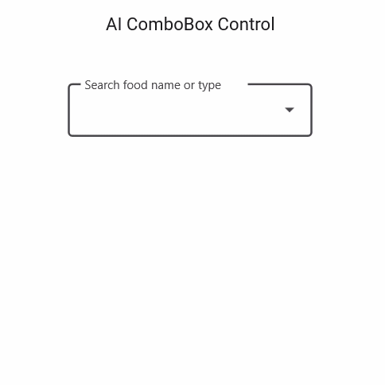

# AI-Powered Smart Filter in .NET MAUI ComboBox

This sample demonstrates AI-powered smart filtering with the Syncfusion® .NET MAUI ComboBox. The application integrates Azure OpenAI to understand natural language search queries and intelligently suggest matching items.

## Overview

Traditional filtering relies on exact text matching, which can make it difficult to discover relevant items when users use natural language descriptions, incomplete keywords, or spelling variations.

This sample uses Azure OpenAI to intelligently analyze user input and identify the most relevant matches from a collection of items.

The AI-powered filtering engine considers:

- Natural language search terms
- Spelling variations and corrections
- Semantic meaning of the search query
- Related item names
- Contextual relevance
- User intent

For example, users can search using phrases such as:

```text
healthy snacks

something spicy

italian food

burger with cheese
```

Azure OpenAI interprets the meaning behind the search query and returns the most relevant items.

The filtered results are displayed directly in the Syncfusion® .NET MAUI ComboBox, providing a more intelligent and user-friendly search experience.

## Key Features

- Syncfusion® .NET MAUI ComboBox integration
- Azure OpenAI-powered smart filtering
- Natural language search support
- Intelligent item recommendations
- Spelling correction and tolerance
- Semantic search capabilities
- Custom filter implementation using FilterBehavior
- Real-time filtering experience
- Context-aware item suggestions
- Cross-platform .NET MAUI application

## Sample

```xml
<inputs:SfComboBox
    x:Name="comboBox"
    IsEditable="True"
    DisplayMemberPath="FoodName">

    <inputs:SfComboBox.FilterBehavior>
        <local:SmartComboBoxFilterBehavior />
    </inputs:SfComboBox.FilterBehavior>

</inputs:SfComboBox>
```

## Output

The AI-powered filter analyzes the user's text and suggests relevant results.

Example searches:

```text
healthy breakfast
```

Suggested items:

```text
Oatmeal
Fruit Salad
Greek Yogurt
```

Example searches:

```text
spicy food
```

Suggested items:

```text
Spicy Chicken Wrap
Mexican Taco
Hot Wings
```

The results are dynamically updated as the user types.



## Prerequisites

Before running the sample, ensure that you have:

- Visual Studio 2022 with .NET MAUI workload installed
- .NET 9 or later
- Azure OpenAI resource and deployment
- Syncfusion® .NET MAUI ComboBox package
- Valid Syncfusion® license key

## Troubleshooting

### Path Too Long Exception

If you encounter a **"Path Too Long"** exception while building the project:

1. Close Visual Studio.
2. Rename the repository folder to a shorter name.
3. Delete the `bin`, `obj`, and `.vs` folders.
4. Rebuild the project.

## License

Syncfusion has no liability for any damage or consequence that may arise from using or viewing the samples. The samples are for demonstrative purposes. If you choose to use or access the samples, you agree to not hold Syncfusion liable, in any form, for any damage related to use, for accessing, or viewing the samples.

By accessing, viewing, or using the samples, you acknowledge and agree that Syncfusion's samples will not allow you to seek injunctive relief in any form for any claim related to the sample.

If you do not agree to this, do not view, access, utilize, or otherwise interact with Syncfusion's samples.