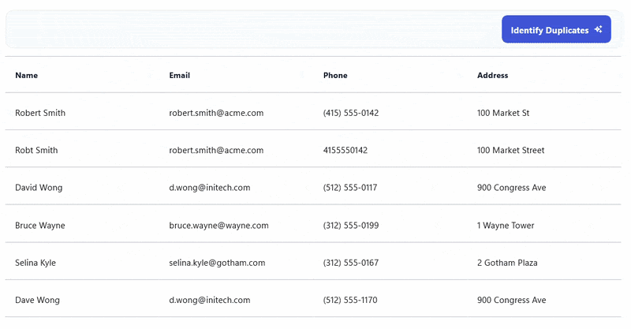

# AI-Driven Duplicate Detection in .NET MAUI DataGrid

This sample demonstrates AI-driven duplicate detection with the Syncfusion .NET MAUI DataGrid. The application integrates Azure OpenAI to analyze customer records, identify exact and near-duplicate entries, and highlight potential duplicates directly within the DataGrid.

## Overview

Duplicate records can impact data quality and lead to inconsistent business information. This sample uses Azure OpenAI to intelligently compare customer records and identify potential duplicates based on similarities across multiple fields.

The AI-powered duplicate detection engine considers:

   - Customer names
   - Email addresses
   - Phone numbers
   - Address similarities
   - Overall record similarity
   - Confidence scores for duplicate matches

The detected duplicates are displayed in the Syncfusion .NET MAUI DataGrid with visual indicators and status information, making it easier to review and manage duplicate records.

## Key Features

   - Syncfusion .NET MAUI DataGrid integration
   - Azure OpenAI-powered duplicate detection
   - Exact and near-duplicate record identification
   - Confidence-based duplicate classification
   - Real-time duplicate detection during editing
   - Visual row highlighting for duplicate records
   - Duplicate review and management workflow
   - Automatic duplicate status updates after record deletion
   - Cross-platform .NET MAUI application

## Sample

```xaml
<syncfusion:SfDataGrid Grid.Row="0"
                       x:Name="CustomerGrid"
                       ItemsSource="{Binding Customers}"
                       AutoGenerateColumnsMode="None"
                       AllowEditing="True"
                       SelectionMode="Single"
                       HeaderRowHeight="60"
                       RowHeight="60"
                       GridLinesVisibility="Horizontal"
                       HorizontalScrollBarVisibility="Always"
                       VerticalScrollBarVisibility="Never"
                       LostFocusBehavior="EndEditCurrentCell"
                       CurrentCellEndEdit="CustomerGrid_CurrentCellEndEdit"
                       BackgroundColor="White">
    <syncfusion:SfDataGrid.Columns>
        <syncfusion:DataGridTextColumn MappingName="Name"
                                       HeaderText="Name"
                                       ColumnWidthMode="Auto"/>
        <syncfusion:DataGridTextColumn MappingName="Email"
                                       HeaderText="Email"
                                       ColumnWidthMode="Auto"/>
        <syncfusion:DataGridTextColumn MappingName="Phone"
                                       HeaderText="Phone"
                                       ColumnWidthMode="Auto"/>
        <syncfusion:DataGridTextColumn MappingName="Address"
                                       HeaderText="Address"
                                       ColumnWidthMode="Auto"/>
        <syncfusion:DataGridTextColumn MappingName="Match"
                                       HeaderText="Match"
                                       ColumnWidthMode="Auto"/>
        <syncfusion:DataGridTemplateColumn MappingName="Status"
                                           HeaderText="Status"
                                           ColumnWidthMode="Auto">
            <syncfusion:DataGridTemplateColumn.CellTemplate>
                <DataTemplate x:DataType="models:Customer">
                    <Border BackgroundColor="{Binding Status, Converter={StaticResource StatusPillColor}}"
                            StrokeThickness="0"
                            StrokeShape="RoundRectangle 6"
                            Padding="8,3"
                            HorizontalOptions="Start"
                            VerticalOptions="Center">
                        <Label Text="{Binding Status}"
                               TextColor="{Binding Status, Converter={StaticResource StatusPillTextColor}}"
                               FontSize="12"
                               FontAttributes="Bold"/>
                    </Border>
                </DataTemplate>
            </syncfusion:DataGridTemplateColumn.CellTemplate>
        </syncfusion:DataGridTemplateColumn>
        <syncfusion:DataGridTemplateColumn HeaderText=""
                                           ColumnWidthMode="Auto"
                                           AllowEditing="False">
            <syncfusion:DataGridTemplateColumn.CellTemplate>
                <DataTemplate x:DataType="models:Customer">
                    <Button Text="&#xE70F;"
                            FontFamily="MaterialAssets"
                            Command="{Binding Source={RelativeSource AncestorType={x:Type local:ViewModel}}, Path=DeleteRowCommand}"
                            CommandParameter="{Binding .}"
                            BackgroundColor="Transparent"
                            TextColor="#94A3B8"
                            BorderWidth="0"
                            FontSize="14"
                            FontAttributes="Bold"
                            Padding="0"
                            WidthRequest="32"
                            HeightRequest="32"
                            CornerRadius="16"
                            HorizontalOptions="Center"
                            VerticalOptions="Center"/>
                </DataTemplate>
            </syncfusion:DataGridTemplateColumn.CellTemplate>
        </syncfusion:DataGridTemplateColumn>
    </syncfusion:SfDataGrid.Columns>
</syncfusion:SfDataGrid>
```

## Output



## Requirements to run the demo

To run the demo, refer to https://help.syncfusion.com/maui/system-requirements

## Prerequisites

Before running the sample, ensure that you have:

- Visual Studio 2022 with .NET MAUI workload installed
- .NET 9 or later
- Azure OpenAI resource and deployment
- Syncfusion .NET MAUI Data Grid package
- Valid Syncfusion license key

## Troubleshooting

### Path too long exception

If you encounter a "Path Too Long" exception while building the project, close Visual Studio, rename the repository folder to a shorter name, and rebuild the project.

## License

Syncfusion has no liability for any damage or consequence that may arise from using or viewing the samples. The samples are for demonstrative purposes. If you choose to use or access the samples, you agree to not hold Syncfusion liable, in any form, for any damage related to use, for accessing, or viewing the samples. By accessing, viewing, or seeing the samples, you acknowledge and agree Syncfusion's samples will not allow you seek injunctive relief in any form for any claim related to the sample. If you do not agree to this, do not view, access, utilize, or otherwise do anything with Syncfusion's samples.