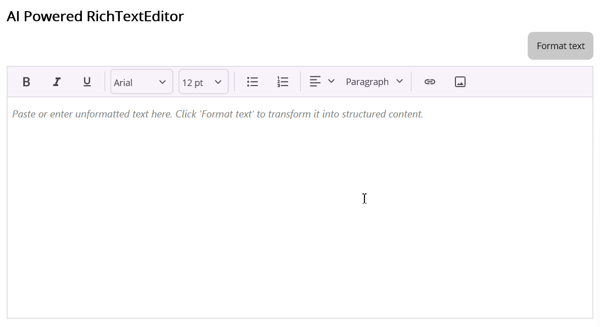

# AI-Powered Content Structuring in .NET MAUI Rich Text Editor

This sample demonstrates how to integrate Azure OpenAI with the Syncfusion .NET MAUI Rich Text Editor (`SfRichTextEditor`). Users can enter or paste unstructured notes, then ask AI to organize the content into a titled document with sections, paragraphs, bullet lists, numbered steps, and action items. The formatted HTML is displayed in the editor, where it can be reviewed and edited further.

## Overview

The sample uses an AI model to organize content while instructing it to preserve the original wording. The model returns structured JSON rather than HTML. The app deserializes that response, converts the supported document elements to HTML, and assigns the HTML to the Rich Text Editor.

The formatting prompt asks the model to:

- Create a document title and logical section headings.
- Place content in paragraphs, unordered bullet lists, ordered lists, or action-item lists as appropriate.
- Preserve source wording and avoid adding information or rewriting the content.
- Return JSON in the expected document structure.

The prompt guides the model but cannot guarantee exact preservation. Review AI-generated output before using or sharing it.

## Key Features

- Syncfusion .NET MAUI Rich Text Editor integration
- Azure OpenAI chat completions integration
- AI-assisted structuring of unformatted text
- HTML rendering of titles, headings, paragraphs, bullet lists, numbered lists, and action items
- Rich Text Editor toolbar for reviewing and editing formatted output
- MVVM-based command and state handling
- Cross-platform .NET MAUI application

## How It Works

1. The user enters or pastes content into `SfRichTextEditor`.
2. The **Format text** command becomes available when the input contains non-whitespace text.
3. `MainPageViewModel` trims the input, indicates that formatting is in progress, and calls `IAIFormattingService`.
4. `AzureOpenAIFormattingService` sends the content to the configured chat completions endpoint with instructions to return structured JSON and preserve the source wording.
5. The response is deserialized into the document model. The service builds HTML from its title, sections, paragraphs, bullet items, numbered items, and action items.
6. The view model updates `FormattedHtml`, which is bound to the editor's `HtmlText` property. The editor's `Text` value is passed to the command as a parameter, so assigning formatted HTML does not write the editor's converted text back into an input binding.
7. If configuration or the AI request fails, the view model exposes the error in the page instead of silently ignoring it.

## Rich Text Editor Integration

The editor's `Text` property supplies input to the format command, while `HtmlText` receives the AI-formatted result:

```xaml
<Button Text="Format text"
        Command="{Binding FormatCommand}"
        CommandParameter="{Binding Source={x:Reference RichTextEditor}, Path=Text}" />

<rte:SfRichTextEditor
    x:Name="RichTextEditor"
    ShowToolbar="True"
    HtmlText="{Binding FormattedHtml}"
    Placeholder="Paste or enter unformatted text here. Click 'Format text' to transform it into structured content." />
```

The **Format text** button passes `RichTextEditor.Text` to `FormatCommand`. The editor is not two-way-bound to a separate input property: setting `HtmlText` can update the editor's plain-text representation, and that should not replace the text being formatted in the view model. An activity indicator is shown while the request is running, and a visible error message is shown if formatting fails.

## Prerequisites

Before running the sample, ensure that you have:

- The .NET 10 SDK and the .NET MAUI workload for your target platform
- A compatible IDE or command-line environment for building .NET MAUI apps
- An Azure OpenAI resource with a chat completions deployment
- A valid Syncfusion license, if required for your use of Syncfusion controls

For supported platforms and development environment details, refer to the [.NET MAUI system requirements](https://help.syncfusion.com/maui/system-requirements).

## Configure Azure OpenAI

The endpoint, API key, and deployment placeholders are declared in `Sample/SmartRTEFormatter/Services/AzureOpenAIFormattingService.cs`. Before running the app:

1. Set `BaseEndpoint` to the base URL for your Azure OpenAI chat completions endpoint. The app appends `/chat/completions` to this value.
2. Set `ApiKey` to the API key for your Azure OpenAI resource.
3. Set `DeploymentName` to the name of a model deployment in your Azure resource.

The request sends the API key in the `api-key` HTTP header. The app displays a configuration error while the endpoint or key is still set to its placeholder. Never commit a real API key or other credentials to a public repository. Because this sample calls the AI service from a client application, credentials embedded in the app can be extracted; use a secured backend or another appropriate secrets strategy for production applications.

## Run the Sample

1. Clone or download this repository.
2. Open `AI Solutions/RichTextEditor/AI powered RTE formatter/Sample/SmartRTEFormatter/SmartRTEFormatter.csproj` in your IDE.
3. Configure the Azure OpenAI endpoint, API key, and deployment as described above.
4. Restore NuGet packages and build the `SmartRTEFormatter` project for a supported target.
5. Run the app, enter or paste some unformatted content, and select **Format text**.

The `SmartRTEFormatter` project references `Syncfusion.Maui.RichTextEditor` and targets .NET 10 for Android, iOS, Mac Catalyst, and Windows (Windows target is included when building on Windows).

## Demo



## Troubleshooting

### Path too long exception

If you encounter a "Path Too Long" exception while building the project, close the IDE, move or rename the repository folder to a shorter path, and rebuild the project.

### Azure OpenAI request fails

Verify that the configured base endpoint is reachable and that appending `/chat/completions` produces a valid endpoint for your Azure OpenAI API version. Confirm that the API key is valid and that `DeploymentName` matches a deployment available in the resource. The service reports unsuccessful HTTP responses as request failures.

## License

Syncfusion has no liability for any damage or consequence that may arise from using or viewing the samples. The samples are for demonstrative purposes. If you choose to use or access the samples, you agree to not hold Syncfusion liable, in any form, for any damage related to use, for accessing, or viewing the samples. By accessing, viewing, or seeing the samples, you acknowledge and agree Syncfusion's samples will not allow you seek injunctive relief in any form for any claim related to the sample. If you do not agree to this, do not view, access, utilize, or otherwise do anything with Syncfusion's samples.
